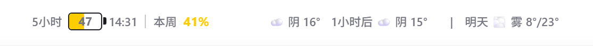

# MyCoMeter

MyCoMeter 是一个 Windows 托盘工具。它在本机将额度和天气组件显示到 Codex Desktop 顶端，直接复用已登录的 Codex 会话。

当前发布版本：[v0.4.10](https://github.com/shinoharasouyoko/codex-meter/releases/tag/v0.4.10)

## 界面预览



上图来自 v0.4.9 的实际运行界面。组件显示五小时和本周额度，右侧依次显示当前、一小时后与明日天气。

## 快速开始

1. 前往 [Releases](https://github.com/shinoharasouyoko/codex-meter/releases) 下载最新的 `MyCoMeter_*_x64-setup.exe`。
2. 运行安装包。推荐使用“含运行环境”版本，无需另装 Node.js。
3. 打开并登录 Codex Desktop。MyCoMeter 会在后台启动，并自动连接本机 Codex。
4. 查看 Codex 顶端。首次连接完成后会显示额度与天气组件。

右键系统托盘中的 MyCoMeter 图标，可以立即刷新、重启 Codex、设置开机启动或退出程序。

## 示例

- `5小时 47`：五小时额度还剩 47%。右侧为下次重置时间。
- `本周 41%`：本周额度还剩 41%。
- `☁️ 阴 16°`：当前位置当前天气。
- `1小时后 ☁️ 阴 15°`：下一小时的预报。
- `明天 ☁️ 雾 8°/23°`：明日天气的最低温与最高温。

## 当前功能

- 在 Codex 标题栏“帮助”菜单后显示剩余额度与重置日期。
- 展示真实额度数据，不包含 Mock 数据或随机刷新逻辑。
- 在额度右侧显示当前和一小时后的本地天气，包括天气 Emoji、中文天气说明与温度。
- 优先展示周额度；接口未提供周额度时回退到短周期额度。
- 额度低于 50% 显示黄色，低于 20% 显示红色，其余显示绿色。
- 后台每 10 秒刷新额度，每 30 分钟刷新天气；托盘菜单支持立即刷新、重启 Codex、开机启动和退出。
- 如果手动关闭并重新打开 Codex 后额度条失效，可右键托盘选择“重启 Codex”。确认后 MyCoMeter 会关闭当前 Codex、以 CDP 模式重新打开，并自动恢复额度组件；无需重启 MyCoMeter。
- 从托盘退出时清理已注入的标题栏组件。
- 兼容 Codex 的应用外壳与 `chatgpt.com` 内嵌 WebView。v0.4.9 会将组件挂到实际可见的 Codex 页面顶部。

## 工作方式

1. Rust 后端只读获取 Codex Desktop 的本机登录信息，并查询额度接口。
2. 后端将规范化后的额度和天气通过标准输入发送给本机 Node.js CDP 注入器。
3. 注入器连接 Codex Desktop，并把电量组件和最新额度同步到标题栏。
4. 页面重新加载或新建窗口时，注入器会自动恢复组件和最新数据。

MyCoMeter 只使用 `127.0.0.1` 上的 CDP。默认端口为 `9335`；端口被占用时会在 `9335–9435` 范围内选择可用端口。托盘中的“重启 Codex”会强制重新建立这条本机 CDP 会话，并重新挂载注入器。

启动时若发现 Codex 未开启本机调试端口，MyCoMeter 会自动重启 Codex 来恢复组件，不再显示确认窗口。手动选择“重启 Codex”仍会要求确认。

额度不可用时显示 `--`，不会猜测或伪造数据。

## 使用要求

- Windows
- 已安装并登录 Codex Desktop（Microsoft Store 稳定版或 Beta 版）
- **精简安装包**需要本机已安装 Node.js；**内置 Node 安装包**不需要
- 从源码开发或构建时需要 Node.js、Rust MSVC 工具链和 Visual Studio Build Tools 的 **Desktop development with C++** 工作负载

## 本地开发

```powershell
npm install
npm test
npm run test:cdp
npm run build
npm run tauri -- dev

# Rust 单元测试
cargo test --manifest-path src-tauri/Cargo.toml --lib
```

## 构建

```powershell
# 生成可执行文件（不含内置 Node）
npm run package:exe

# 生成两套 MSI / NSIS：精简版 + 内置 Node 版
npm run package:windows
```

`package:windows` 产物：

- 精简版：`src-tauri/target/release/bundle/msi/`、`nsis/`（需系统 Node）
- 内置 Node 版：`src-tauri/target/release/bundle/with-node/msi/`、`with-node/nsis/`（文件名带 `-with-node`，约多 ~87MB）

## 关键文件

- `src-tauri/src/codex.rs`：读取登录状态并查询真实额度。
- `src-tauri/src/weather.rs`：通过 IP 获取城市级近似坐标，并查询当前、一小时后和明日天气。
- `src-tauri/src/models.rs`：将接口数据映射为注入器消息。
- `src-tauri/src/cdp.rs`：`ensure_codex_cdp` / `restart_codex_cdp`、状态持久化、注入器进程管理。
- `src-tauri/resources/resolve-codex-install.ps1`：解析 Store 包身份（稳定版 / Beta）。
- `src-tauri/resources/launch-codex-cdp.ps1`：COM 启动、owl 回退、端口扫描（9335–9435）、CDP 校验。
- `src-tauri/resources/injector.mjs`：连接 Codex Desktop 并分发额度数据。
- `src-tauri/resources/inject.js`：标题栏电量组件及样式。
- `src/inject.test.ts`：注入位置、真实数据渲染和清理测试。
- `scripts/test-cdp-launch.ps1`：CDP 启动辅助自检（命令行状态 / 端口冲突）。

## 隐私说明

应用只在本机读取 Codex 登录状态并查询额度，不上传 token、账户 ID 或聊天内容。

天气功能会向 `ipwho.is` 发送本机公网 IP，以获得城市级近似坐标，不使用 GPS，也不会在本机保存 IP、城市名或经纬度。随后向 Open-Meteo 发送该近似坐标获取天气。Open-Meteo 的免费接口仅限非商业使用，天气数据遵循 CC BY 4.0，详见 [Open-Meteo 条款](https://open-meteo.com/en/terms)。

## 常见问题

### 安装后没有显示

先确认 Codex Desktop 已经打开并完成登录。等待几秒后仍未显示时，右键托盘图标，选择“立即刷新”。如果 Codex 更新后切换了页面结构，可选择“重启 Codex”让 MyCoMeter 重新建立本机 CDP 连接。

### 为什么天气偶尔显示不可用

天气服务需要先用公网 IP 取得城市级坐标，再获取 Open-Meteo 预报。网络暂时不可用、定位服务超时或天气服务异常时，组件会显示简洁占位状态，额度显示和 10 秒刷新不会受影响。

### MyCoMeter 会读取聊天内容吗

不会。它只读取本机 Codex 的额度状态，并向页面发送用于显示的额度和天气字段。MyCoMeter 不上传聊天内容、登录 token 或账户 ID。
