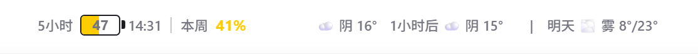

## MyCoMeter v0.4.9

### 已修复

新版 Codex 将实际可见界面放进 `chatgpt.com` 内嵌 WebView。此前 MyCoMeter 只向 `app://` 应用外壳注入组件，后台进程运行正常，用户却看不到组件。

v0.4.9 会识别受限的 `chatgpt.com` Codex WebView，并在页面具备可拖动顶栏和输入区域时，将组件固定显示在顶部。旧版应用外壳路径仍然保留。

### 使用方法

1. 下载并运行 `MyCoMeter_0.4.9_x64-setup.exe`。
2. 打开并登录 Codex Desktop。
3. 在 Codex 顶端查看五小时、本周额度和天气。
4. 右键系统托盘的 MyCoMeter 图标，可以立即刷新或重启 Codex。

### 刷新与隐私

- 额度每 10 秒刷新，天气每 30 分钟刷新。
- 时间使用 `Asia/Shanghai`。
- 天气定位会向 `ipwho.is` 发送公网 IP，获取城市级近似坐标。应用不使用 GPS，也不保存 IP、城市或经纬度。
- MyCoMeter 不读取或上传聊天内容、账户 ID 和 token。

### 验证

- 前端测试：13 项通过。
- Rust 测试：25 项通过。
- 格式检查、前端构建和 Windows 安装包构建通过。
- 已在运行中的 Codex WebView 确认组件存在、可见并位于顶部。
