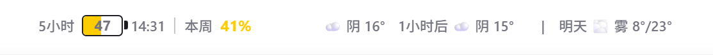

# MyCoMeter v0.4.9

## 这次修复了什么

Codex 更新后，实际可见界面转入 `chatgpt.com` 内嵌 WebView。旧版只向 `app://` 应用外壳注入组件，后台进程正常运行，组件却落在用户看不到的页面。

v0.4.9 会识别受限的 `chatgpt.com` Codex WebView，并确认页面具备可拖动顶栏和输入区域后再注入。组件固定在页面顶部，保留旧版应用外壳的兼容路径。

## 使用方式

1. 安装 `MyCoMeter_0.4.9_x64-setup.exe`。
2. 打开并登录 Codex Desktop。
3. 在 Codex 顶端查看五小时、本周额度和天气信息。
4. 需要时右键托盘图标，选择“立即刷新”或“重启 Codex”。

## 刷新规则

- Codex 额度每 10 秒刷新。
- 天气每 30 分钟刷新。
- 手动“立即刷新”会同时请求额度和天气。
- 时间使用电脑的东八区设置，天气请求使用 `Asia/Shanghai`。

## 隐私与网络

MyCoMeter 只通过本机 `127.0.0.1` CDP 与 Codex Desktop 通信。它不读取或上传聊天内容、账户 ID 和 token。

天气定位会将公网 IP 发送给 `ipwho.is`，取得城市级近似位置。应用不使用 GPS，也不保存 IP、城市或经纬度。天气预报来自 Open-Meteo。

## 验证

- 前端测试：13 项通过。
- Rust 测试：25 项通过。
- 格式检查、前端构建和 Windows 安装包构建通过。
- 已在运行中的 Codex WebView 验证组件存在、可见、位于顶部并处于最高层级。
